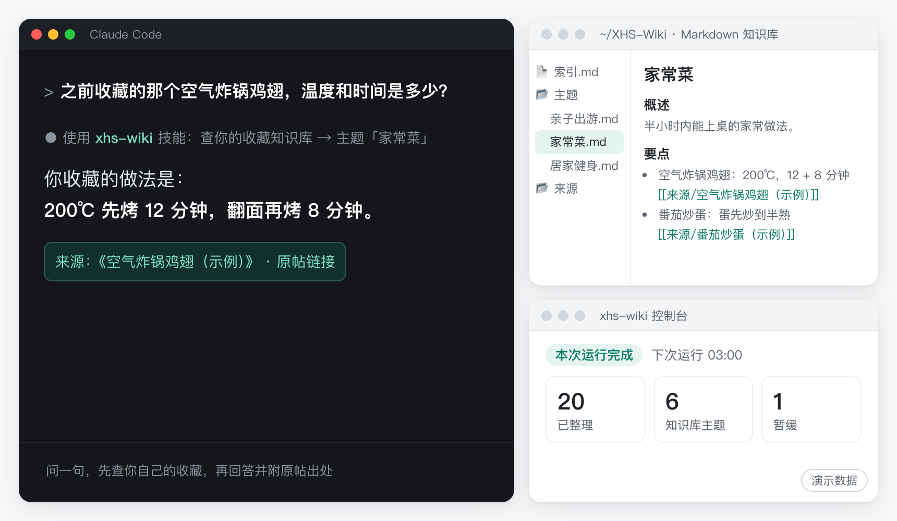
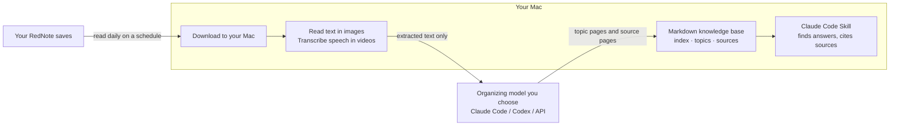

<div align="center">


# xhs-wiki

**Your RedNote saves, finally useful to your AI.**

Don't let your saves gather dust: turn your RedNote (Xiaohongshu) favorites into a personal knowledge base your AI can search.

[简体中文](README.md) · **English**

[See it in action](#see-it-in-action) · [Quick start](#quick-start) · [Before you install](#before-you-install) · [Claude Code & Obsidian](#use-it-with-claude-code-and-obsidian) · [Where your data goes](#where-your-data-goes) · [Risks and disclaimer](#risks-and-disclaimer) · [FAQ](#faq)


[](https://github.com/tyr1105/xhs-wiki/actions/workflows/test.yml)


<sub>[Unofficial tool](#risks-and-disclaimer) · Only your own saves · Mac only · Image text recognition and video transcription run on your Mac · Organizing uses your own model subscription or API</sub>



</div>

Your RedNote saves keep piling up, and when you need one, you can scroll forever without finding it. What was said in a video or written on an image is worse: there's no way to search it. Ask an AI assistant, and it has no idea what you saved, so you get a generic answer.

**xhs-wiki** downloads your new saves to your Mac every day, reads the text in images and transcribes the speech in videos right on your Mac, then hands that text to the AI model you choose, which organizes it into a knowledge base grouped by topic (plain Markdown files, the kind of text notes any editor can open). Later, when you ask Claude Code (Anthropic's AI assistant) about something you saved, it uses the query Skill that xhs-wiki installs (a short set of instructions for Claude Code) to check your own saves first, then answers with its sources (the title and link of each saved post it drew on). You can also ask it outright to check your saves.

This project grew out of the author's own workflow (that workflow has already turned **1,100+ RedNote saves** into a personal knowledge base and keeps up with new saves every day). xhs-wiki is its general-purpose, open-source version; the author has run it end to end on a fresh install, importing the latest 20 saves.

> [!NOTE]
> **For English speakers:** the setup console, the installer's messages and the knowledge base are in Chinese. Folder and file names are Chinese (`索引.md` for the index, `主题/` for topics, `来源/` for sources), and because the organizing prompts are written in Chinese, topic pages come out with Chinese headings and usually Chinese text. You can usually ask Claude Code in English and get answers in English, but this hasn't been systematically tested. So far the tool has only been tested with RedNote accounts registered in mainland China. The daily run time you set in the console is Beijing time (UTC+8). More in [Do I need to read Chinese?](#do-i-need-to-read-chinese)

## See it in action

```text
You:     Any places I saved for a weekend outing with the kids?

Claude:  I checked your knowledge base. The "亲子出游" (family outings) topic
         has 3 related saves:
         1. A wetland park that suits a half-day trip: not crowded, big lawns,
            good for ages 3–6 (source: "…")
         2. …
         3. …

You:     The air-fryer chicken wings I saved: what temperature, and how long?

Claude:  The recipe you saved says 200°C for 12 minutes, flip, then another
         8 minutes (source: "…").
```

<sub>A made-up example, translated into English to show the idea. Your knowledge base holds only your own saves; for anything you never saved, the Skill tells Claude to say plainly that there's nothing.</sub>

## What it does: daily organizing, video to text, answers with sources

- **Find things when you need them.** Ask in your own words; no need to remember titles. What was said in videos and the text on images can be found too. Saves on the same topic are merged into one page, and answers cite their sources (the title and link of each saved post). The Skill also tells Claude to say so when nothing matches, rather than make something up.
- **Set it up once, and it keeps up.** One command installs it: no Python setup, no Homebrew, git or ffmpeg, and no hunting for cookies. When it's done, your browser opens the console; walk through the 5-step wizard (one step is a QR-code login) and organizing begins. After that, new saves are picked up every day at 03:00 Beijing time (UTC+8) by default. If your Mac is asleep at that moment, that's fine: it catches up when it wakes. If a note (RedNote's word for a post) fails, the console shows why, and you can retry it on its own.
- **Your data stays yours.** Text in images is read with macOS's built-in recognition, and speech in videos with Whisper by default, both on your Mac. Original images and videos are never sent to the organizing model; by default they're deleted once verified, leaving only the organized text. You pick the organizing model: Claude Code or Codex on your existing subscription, or Anthropic's API or any OpenAI-compatible API (including a model server running on your own Mac). What you get is a plain Markdown folder that Obsidian or any editor can open, with no lock-in to any platform, and uninstalling keeps it by default.

## Who it's for

**A good fit if you:**

- use a Mac (macOS 13 or later, Apple silicon or Intel) and have saved lots of guides, tutorials and lists on RedNote that you can never find when you need them;
- already use Claude Code (Anthropic's AI assistant) or Codex (OpenAI's coding assistant for the command line, included with paid ChatGPT plans), or are willing to set up a pay-as-you-go model API (see [Choosing an organizing model](#choosing-an-organizing-model));
- keep a personal knowledge base in Obsidian or a similar tool and want your RedNote saves in it too;
- read Chinese, or are fine with a Chinese console and knowledge base (see [Do I need to read Chinese?](#do-i-need-to-read-chinese)).

To "just ask and find it", you currently need to ask in Claude Code. Without Claude Code, you can still browse the organized knowledge base in Obsidian or any editor. So far the tool has only been tested with RedNote accounts registered in mainland China (see [this FAQ](#does-it-work-with-a-rednote-account-registered-outside-mainland-china)).

**Not a fit (yet) if you:**

- use Windows or Linux, or only use your phone;
- want to fetch posts by creator, keyword or link, repost content, or run data analysis: it only processes posts you saved with your own account;
- don't want extracted text sent to a cloud model service and don't plan to run a model on your Mac, or can't accept any risk to your account (see [Risks and disclaimer](#risks-and-disclaimer)).

## Before you install

**Could this affect my RedNote account?** We can't promise it won't. It uses the session from your QR-code login, in a separate Chrome profile, to read your own saves. That is automated access and may violate the platform's terms of service; any risk to your account is yours. By default it runs once a day at 03:00 Beijing time and downloads at most 100 new saves per run; while saves are still waiting, the service starts a follow-up run an hour after the previous one ends, at most 6 extra runs a day. Reading your saves uses Google Chrome on your Mac, and this project doesn't change its user agent (the ID string a browser reports to websites); the download component, XHS-Downloader, keeps its upstream default and imitates Chrome's network fingerprint (TLS and request headers). There's no other anti-detection. It never solves captchas: if scanning your saves hits a captcha or an access block, it stops right away and never tries to get around it; during downloads, a save that can't be fetched is marked as failed, and if 3 saves in a row fail in the same run (a likely sign of a platform limit), it pauses the rest of that run's downloads, tells you under "待你处理" (Needs your attention), and waits for the next scheduled run. → [Risks and disclaimer](#risks-and-disclaimer)

**Is the installer safe to run?** The code is open source (GPL-3.0-or-later), so you can read it before installing. The install script prints what it's doing at every step, and asks you before installing uv, setting up the service that starts at login, or creating the `xhs-wiki` command. Add `--dry-run` to preview: it only prints the steps, and creates, downloads and changes nothing. The console listens only on your Mac and opens only with an access token that only you can read. You can uninstall anytime, and your knowledge base is kept by default. → [Quick start](#quick-start) · [Uninstall](#uninstall)

**Where does my data go?** The knowledge base, processing records and login state stay on your Mac. When organizing, the text extracted from your saves (title, author, publish time, the post's link without its signature, body text, tags, transcripts and text from images) goes to the organizing model you choose; original images and videos don't. So organizing isn't fully offline, unless the model you connect runs on your own Mac. → [Where your data goes](#where-your-data-goes)

**What does it cost?** The tool itself is free and open source, with no paid version. Organizing runs on your own model: a paid Claude or ChatGPT plan (for Claude Code and Codex respectively), or a pay-as-you-go API; more saves means more calls. The project doesn't provide any credits. For your first import, pick the latest 20 saves to see the results and the usage. → [Choosing an organizing model](#choosing-an-organizing-model)

**Can I install it from mainland China?** You need to be able to reach GitHub, where the install script and the source package are hosted. If GitHub works but Python packages or the speech model download slowly, add `--mirror cn` when installing to switch to mirrors in mainland China. Outside mainland China you don't need it. → [Installing in mainland China](#installing-in-mainland-china)

**I don't code. How hard is it, and how long does it take?** You paste one command into Terminal and answer a few yes/no questions; everything else is clicking through 5 steps in your browser, one of them a QR-code login. There's no Homebrew, git or ffmpeg to install first. What you do need ready beforehand is Google Chrome and an organizing model. The organizing model means a working, logged-in `claude` (Claude Code) or `codex` (Codex) command in Terminal, or a model API key (see [Choosing an organizing model](#choosing-an-organizing-model)); that's the most hands-on part. If you don't have one yet, set it up and log in following its official instructions before installing. Without it you can still finish the wizard, but the first run stops with "整理模型不可用" (organizing model unavailable). The installer downloads a Python runtime and dependencies, and the default speech model (about 1.5 GiB) downloads in the background without holding up the setup, so speed mostly depends on your network. For how long the first organizing run takes, see [I have a lot of saves. How long will it take?](#i-have-a-lot-of-saves-how-long-will-it-take) → [Quick start](#quick-start)

## Quick start

> [!IMPORTANT]
> Before you run the installer, please read [Risks and disclaimer](#risks-and-disclaimer): this is an unofficial tool, not affiliated with Xiaohongshu (RedNote) in any way, and it only organizes **your own** saves. Using it may violate the platform's terms of service, and any risk to your account is yours.

**You need:** macOS 13 or later (Apple silicon or Intel), Google Chrome, a network that can reach GitHub, at least 10 GiB of free disk space (about 13 GiB is safer), and one organizing model (see [Choosing an organizing model](#choosing-an-organizing-model)). No Homebrew, git or ffmpeg, and you don't install Python yourself. The full list is under [Requirements](#requirements).

**Step 1: open Terminal and paste one command.** Terminal is the command-line app that comes with every Mac: press Command + Space, type "Terminal" and press Return. Paste this line and press Return:

```bash
curl -fsSL https://raw.githubusercontent.com/tyr1105/xhs-wiki/main/install.sh | bash
```

On a network in mainland China where Python packages or the speech model download slowly, use the command with mirrors instead; see [Installing in mainland China](#installing-in-mainland-china).

The installer's messages are in Chinese. Along the way it asks up to three yes/no questions: whether to install uv if it's missing (uv is the tool the installer uses to set up Python), whether to start xhs-wiki in the background whenever you log in, and whether to add the `xhs-wiki` command to `~/.local/bin`. When you see `[y/N]`, type `y` and press Return to agree; pressing Return alone means no. If you decline uv, the install stops; to continue, run the same command again and answer `y` to that question.

**Step 2: walk through 5 steps in your browser.** When the install finishes, your browser opens the local console (a web page served only on your Mac). To open it again later, run `xhs-wiki open` in Terminal. The top of the page shows download progress for the download component and the speech model, and you can do the setup in the meantime:

知识库位置 (knowledge base location) → 引擎 (engine) → 整理模型 (organizing model, with a "测试" Test button) → 扫码登录 (QR-code login) → 导入范围 (import range)

For the first import, pick "最近 20 条（推荐，先看效果）" (latest 20, recommended), then click "完成并开始" (Finish and start). This choice only affects the first import; new saves are processed every day after that. Organizing starts by itself once the downloads finish, and the console shows the progress, so there's no need to watch it.

**Step 3: ask in Claude Code.** Once your saves are organized, try questions like these (examples):

- "Check my saves for good places to take the kids on a weekend." (查一下我的收藏里有没有适合周末带孩子去的地方。)
- "Based on what I've saved, how do I make air-fryer chicken wings?" (根据我之前存过的内容，空气炸锅鸡翅怎么做？)
- "Which prompt tips for writing weekly reports have I saved?" (我之前收藏过哪些写周报的提示词技巧？)
- "Which saved post does this conclusion come from?" (这条结论来自哪篇收藏？)

Asking in English usually works but hasn't been systematically tested. If Claude Code doesn't check your saves on its own, name the Skill: "Use xhs-wiki to check …".

No Claude Code? Open the knowledge base folder (`~/XHS-Wiki` by default) in Obsidian or any editor. From then on, new saves are picked up every day at 03:00 Beijing time by default; to bring in older saves as well, see [First-run setup](#first-run-setup-the-console-wizard).

Want to see what the installer would do first? You can preview it without installing. It only prints the steps; it creates, downloads and changes nothing:

```bash
curl -fsSL https://raw.githubusercontent.com/tyr1105/xhs-wiki/main/install.sh | bash -s -- --dry-run
```

You can also [uninstall](#uninstall) anytime, and your knowledge base is kept by default.

<details>
<summary>The careful way: download the repository, read the script, then install</summary>

1. On this repository's page, click **Code → Download ZIP** and unzip it (or use `git clone` if you know git).
2. Open `install.sh` in a text editor and read it; every step is commented (in Chinese).
3. In Terminal, type `cd` followed by a space, drag the unzipped folder into the Terminal window, and press Return.
4. Run:

   ```bash
   bash install.sh --from-local .
   ```

To skip starting xhs-wiki in the background at login, add `--no-launch-agent` to the end of that command.

</details>

<details>
<summary>Already use Claude Code? Ask it to review the installer first</summary>

Open Claude Code in the downloaded repository folder and send it this message:

```text
Please read install.sh in this repository and explain step by step what it would do on my Mac: what it checks, what it downloads, where it writes, and which steps ask for my consent. Only run it with --dry-run to show me; don't actually install. I'll run the real install and the QR-code login myself.
```

Run the real install yourself in Terminal: the script asks for your consent there, item by item, and in an environment without a terminal (for example, when an AI runs it for you) it stops right away instead of deciding for you.

</details>

## How it works



1. **Read and download**: on a daily schedule, it reads your saves list from the top, finds new saves and downloads them to your Mac.
2. **Recognize and transcribe on your Mac**: text in images is recognized with macOS Vision; the audio in videos is decoded on your Mac and transcribed with Whisper large-v3-turbo by default.
3. **Organize**: the extracted text goes to the organizing model you choose, which turns it into topic pages and source pages; then an index is generated. Notes with too little content are marked "暂缓" (deferred), keeping whatever source information is usable.
4. **Clean up originals**: on by default (you can turn off "每天自动清理已入库的原件", daily cleanup of imported originals, under "定时设置", Schedule). Downloaded images and videos are deleted only after both the import result and a file-integrity check pass. The organized knowledge base is kept, and originals that fail the check are kept too; nothing is deleted just because a run finished. In the author's test, after 3 saves (including videos) were imported, cleaning up the originals freed 358 MB.
5. **Ask**: the installed Skill is a set of query instructions for Claude Code: check your knowledge base first, then answer and cite the sources.

In the organizing step, xhs-wiki sends only the extracted text to the model you choose; whether it leaves your Mac depends on that service, and Codex comes with one extra caveat. When you ask Claude Code a question, whatever it reads from your knowledge base also goes to the model service Claude Code uses (for both, see [Where your data goes](#where-your-data-goes)). The local console shows progress, lets you change settings, and starts a run by hand.

## Use it with Claude Code and Obsidian

xhs-wiki gives you two things: a plain Markdown folder, and a Skill that tells Claude Code to check it first.

**Claude Code: checks your saves when you ask**

- The query Skill lives at `~/.claude/skills/xhs-wiki/SKILL.md`. The installer writes it first if it finds Claude Code; when you finish the first-run setup, the service rewrites it with your final knowledge base location and removes the "setup not finished" note. It's written even if you don't have Claude Code yet, so it works once you install Claude Code, with no need to run the install command again.
- Ask the way you normally would, for example: "Check my saves for anything related." "Answer this based on what I've saved." "Which saved post does this conclusion come from?" The Skill's description (in Chinese) tells Claude to check your saves first when you say things like "我收藏的" (what I saved) or "我之前存过" (I saved this before), or when you ask for recommendations, guides, methods or lists. Whether to use the Skill is up to Claude Code; if it doesn't check, say "Use xhs-wiki to check …".
- The Skill reads the index first, then topics and sources, and also searches the source pages when the index has no match. It asks Claude to cite sources (the source page title and the RedNote link; that link may not open in a desktop browser, see [Why don't the original-post links open?](#why-dont-the-original-post-links-open)), and to say so when nothing is found rather than make something up.
- The Skill is a short set of query instructions, under 30 lines; you can read the template before installing: [SKILL.md.tmpl](src/xhs_wiki/skill/SKILL.md.tmpl) (in Chinese). It includes a "内容安全" (content safety) rule telling Claude to treat your saves only as material to quote and paraphrase, and never to act on instructions, commands, code or links that appear in a post unless you explicitly ask it to in the conversation. This is an instruction to the AI: it lowers the risk of someone hiding instructions in a post, but it isn't an absolute guarantee.
- When Claude Code is your organizing model, it runs non-interactively: it can't read files outside the working folder used for organizing, doesn't load your MCP servers or Skills, and doesn't save the session on your Mac. With the default lightweight engine, xhs-wiki calls it directly with all tools turned off and without reading your settings files (see [claude_code.py](src/xhs_wiki/llm/claude_code.py)); with the LLM Wiki engine, its backend calls it and, when needed, turns on only a few read-only tools for reading and searching files, limited to that run's temporary working folder.
- Already have a similar Skill for searching your saves? Two Skills may both respond to the same question, so keep only one.

**Codex: organize with your subscription**

Codex is OpenAI's coding assistant for the command line, included with paid ChatGPT plans. If you have a working, logged-in `codex` command on your Mac, you can choose Codex as the organizing model in the wizard and use your existing subscription. For now only Claude Code gets the query Skill installed automatically; if you choose Codex or an API, it only does the organizing. For a privacy caveat specific to Codex, see [Where your data goes](#where-your-data-goes).

**Obsidian: open the knowledge base folder**

In Obsidian, open `~/XHS-Wiki` as a vault ("Open folder as vault").

```text
~/XHS-Wiki/            default location; change it in the setup wizard
├── 索引.md            index of all topics
├── 暂缓.md            deferred saves with too little content
├── 主题/              topics
│   ├── 亲子出游.md      e.g. "family outings": several saves merged into one page
│   └── 家常菜.md        e.g. "home cooking"
├── 来源/              sources: one page per save, keeping its text and where it came from
└── .xhs-wiki/         the engine's own records (hidden folder; leave it alone)
```

<sub>The folder structure matches what the tool generates; the topic names are made-up examples. Your topics come from your own saves, with no preset categories.</sub>

- Every topic page has the same five sections (概述 overview, 要点 key points, 对比与推荐 comparisons and picks, 注意事项 caveats, 来源 sources). Key points are tagged with wikilinks (`[[来源/…]]`) to the saves they came from; the organizing model is asked to do this, so an occasional point may lack one.
- Each source page starts with frontmatter (a small block of properties at the top of the file) with the fields `note_id`, `url`, `author`, `published_at`, `topics` and `status`, so plugins such as Dataview can query by property. The body has a summary, key points and details, and the original text (body, transcript, text from images) is folded at the end of the page.
- Topic pages and the index are maintained by the tool: when a new save joins a topic, that page is rewritten in full, so don't write your own content in `主题/` or `来源/`. For your own notes, create a separate folder inside the knowledge base folder (for example `my-notes/`), write there, and link to the pages with `[[主题/…]]`. Purging the knowledge base on uninstall doesn't delete that folder, and if you later change the knowledge base location, it stays in the old folder.
- The knowledge base can't be placed inside `~/Library`, so an Obsidian vault stored in iCloud can't be used directly as its location (the newer Dropbox, Google Drive and OneDrive sync folders are inside `~/Library` too, so they can't be used either); we suggest opening `~/XHS-Wiki` as its own local vault.
- You don't need Obsidian: any text editor works. This repository ships no one's topic categories.

## Where your data goes

**Organizing is not fully offline.** Text recognition and transcription happen on your Mac; the organizing step sends the extracted text to the model you choose, and whether that text leaves your Mac depends on the service you pick (if it's a model server running on your Mac, organizing happens on your Mac too).

| Stored on your Mac | Sent to the organizing model you choose | Not sent to the organizing model |
|---|---|---|
| Knowledge base, originals being processed, processing records, RedNote login state; API keys in the macOS Keychain | Extracted title, author, publish time, the post's link without its signature, body text, tags, transcripts and text from images, plus the summaries and topic text needed for organizing | Original images and videos (by default deleted automatically once imported and verified) |

With Codex there's one more thing to know. xhs-wiki still sends it only the extracted text, but Codex keeps its own tools (in a read-only sandbox that can still read files on your Mac) and loads your own Codex settings. Text hidden in a post could trick it into reading other files on your Mac; whatever it reads goes to the model service and may end up in your knowledge base. With Claude Code, it can't read files outside the working folder used for organizing, and it doesn't load your MCP servers or Skills (see [Use it with Claude Code and Obsidian](#use-it-with-claude-code-and-obsidian)).

Login uses a separate Chrome profile and doesn't read anything else from your everyday browser. API keys are never written to `settings.json`. This repository contains only the tool, never anyone's saves, knowledge base or topic categories.

When you ask Claude Code a question, whatever it reads from your knowledge base becomes part of that conversation and goes to the model service Claude Code uses, just as when you ask it to read any other file on your Mac.

If a post is later deleted or hidden by its author, the text already organized into your knowledge base stays on your Mac. It's for your own reference only; please don't redistribute it.

Default locations (`~` is your home folder; these are the general defaults):

| What | Where |
|---|---|
| Knowledge base | `~/XHS-Wiki/` (changeable in the setup wizard) |
| App, settings and processing records | `~/Library/Application Support/xhs-wiki/` |
| RedNote login state | `browser-profile/` inside the app folder above |
| Speech models, originals being processed | `models/` and `work/` inside the app folder above |
| Service logs | `~/Library/Logs/xhs-wiki/` |
| Claude Code query Skill | `~/.claude/skills/xhs-wiki/SKILL.md` |
| API keys | macOS Keychain |

## Risks and disclaimer

- This is an unofficial tool, not affiliated with Xiaohongshu (RedNote).
- Using it may violate the platform's terms of service. Any risk to your account is yours.
- It only processes posts you saved with your own account, and can't fetch any content by creator, keyword or link. What it organizes is for your own reference; don't redistribute other people's content.
- Reading your saves uses Google Chrome on your Mac, and this project doesn't change its user agent (the ID string a browser reports to websites). The download component, XHS-Downloader, keeps its upstream default: when it fetches post pages, images and videos, it imitates Chrome's network fingerprint (TLS and request headers). We tried turning that off: RedNote then redirects post-page requests to the login page and returns no content, so we kept the upstream default (evaluation and evidence in [#1](https://github.com/tyr1105/xhs-wiki/issues/1)). Beyond that, this project does no anti-detection.
- It never solves captchas. If scanning your saves or the QR-code login hits a captcha or an access block, it stops immediately and never tries to get around it (for scanning, "待你处理" (Needs your attention) in the console explains why). The download step doesn't recognize verification pages, but it watches the results: a save that can't be fetched is marked as failed, and if 3 saves in a row fail in the same run, it pauses the rest of that run's downloads, tells you under "待你处理" (Needs your attention) with a system notification, and does not start a follow-up run an hour later; it tries again at the next scheduled run, and the notice clears itself once a download succeeds. The same save is tried at most 3 times in a row, and this kind of failure is queued again automatically every 7 days.
- We don't recommend raising the default run frequency or the number of new saves per run.
- Login is by QR code only: it never needs your RedNote password, and you never have to hand over cookies.
- So far it has only been tested with RedNote accounts registered in mainland China.
- This project is free and open source ([tyr1105/xhs-wiki](https://github.com/tyr1105/xhs-wiki)), with no paid version; the author hasn't authorized anyone to charge for installing it.
- This is a personal open-source project with no maintenance commitment. Changes on RedNote's side may break reading your saves or downloading; when something fails, the console shows why. Your already-organized knowledge base is just files on your Mac and isn't affected.

## Requirements

- **Mac: macOS 13 or later.** Apple silicon and Intel are both supported; the optional LLM Wiki engine needs Apple silicon. Automated tests (GitHub Actions) run the full test suite on macOS 15, on both Apple silicon and Intel. The author's real-machine installs were all on Apple silicon Macs; Intel Macs and macOS 13 haven't been verified on real hardware yet. If you run into problems, please [open an issue](https://github.com/tyr1105/xhs-wiki/issues).
- **Google Chrome**, installed in the standard Applications folder. It's used for the QR-code login and for reading your own saves.
- **An organizing model:** one of the [four options](#choosing-an-organizing-model), using your own subscription or API credits.
- **Disk:** the installer checks for at least **10 GiB** free. After that, every run also needs at least 10 GiB free before it starts; with less, it doesn't start, and "待你处理" (Needs your attention) tells you why. Downloading originals also stops below 10 GiB. The app environment and the default speech model take up a bit over 2 GiB once installed, so leave about 13 GiB free before installing. The default speech model is about **1.5 GiB**; the fast mode is about **227 MiB**, including a tiny voice-activity model. Leave room for originals being processed and your knowledge base too.
- **Network:** you need to be able to reach GitHub. The install script, the xhs-wiki source package, the download component (XHS-Downloader) and the SenseVoice model all come from GitHub; if uv isn't installed yet, uv's official installer is fetched from astral.sh first (and it then downloads uv itself); the Python runtime is downloaded by uv (also from GitHub by default), and Python dependencies come from PyPI; the default Whisper speech model comes from Hugging Face and switches automatically to the mirror hf-mirror.com if Hugging Face can't be reached. The fixed addresses and checksums of the component and models are in [assets_manifest.json](src/xhs_wiki/assets_manifest.json); for networks in mainland China, see [Installing in mainland China](#installing-in-mainland-china).

The installer sets up its own Python 3.12 environment, so you don't install Python yourself, and you don't need Homebrew, git or ffmpeg. It uses uv to manage that environment and asks before installing uv if it's missing.

## Installing in mainland China

This section is for networks in mainland China; elsewhere, you can skip it.

The install script and the xhs-wiki source package are hosted on GitHub, so you **need to be able to reach GitHub**. If Terminal shows `Could not resolve host`, `Failed to connect to raw.githubusercontent.com`, `SSL_ERROR_SYSCALL` or `Connection reset by peer`, or the command just hangs (press Control + C to stop it), your network can't reach GitHub and nothing has been installed yet; switch to a network that can, and run the same command again.

If GitHub works but Python packages or the speech model download slowly, add `--mirror cn` when installing:

```bash
curl -fsSL https://raw.githubusercontent.com/tyr1105/xhs-wiki/main/install.sh | bash -s -- --mirror cn
```

If you already have the repository files, run `bash install.sh --from-local . --mirror cn` in the repository folder.

If the install stops partway with "创建虚拟环境失败" (failed to create the virtual environment) or "从远程安装 xhs-wiki 失败" (failed to install xhs-wiki from the remote source), downloading the Python runtime or dependencies most likely failed: run the same command again with `--mirror cn`, and if it still fails, switch to a network with a steadier connection to GitHub.

With `--mirror cn`, these three kinds of downloads switch to mirrors in mainland China:

| Download | Mirror used |
|---|---|
| Python packages (dependencies of xhs-wiki and of the download component) | Alibaba Cloud PyPI mirror |
| Python runtime (the prebuilt Python 3.12 that uv sets up) | npmmirror |
| Whisper speech model | hf-mirror.com |

The mirror settings apply only to this install and the background service it starts; they aren't written into your shell configuration. The install script itself, the xhs-wiki source package, the download component XHS-Downloader and the SenseVoice model still come from GitHub, and if uv isn't installed yet, uv's official installer still comes from astral.sh.

Even without `--mirror cn`, Whisper has an automatic fallback: it tries Hugging Face first and switches to hf-mirror.com if that can't be reached (if the `HF_ENDPOINT` environment variable is set, that address is tried first). Wherever a file comes from, it has to match a fixed SHA-256 checksum, or it isn't used.

## What the installer does

The command in [Quick start](#quick-start) goes through these steps in order: check the macOS version and disk space → check for Google Chrome → check for uv (asking before installing it if it's missing) → create a separate Python 3.12 environment and install xhs-wiki (the remote install downloads a source archive, so no git is needed) → start the background service and open the console → write the query Skill (if Claude Code is detected) → create the `xhs-wiki` command (asking first). If you already have the repository files, you can instead go to the repository folder in Terminal and run the local installer:

```bash
bash install.sh --from-local .
```

If the installer installs uv for you, it uses uv's official installer (downloaded from astral.sh), which may add a line to a shell startup file such as `~/.zshrc` to put `~/.local/bin` on your PATH. Uninstalling xhs-wiki doesn't undo that line or remove uv.

The download component and the speech model are fetched by the service in the background, with progress at the top of the page; you can finish the wizard meanwhile, and importing starts only once everything is ready. Downloads use the system's own curl, and when restarted after a network interruption they resume where they left off; if a download fails, click "重试" (Retry) at the top of the console.

The installer asks whether to install a **LaunchAgent**, the macOS mechanism for starting background programs when you log in. With it, the service keeps handling the daily schedule. Without it, a temporary service still starts for this session, but after you restart your Mac you'll need to run `xhs-wiki serve` yourself and keep that Terminal window open. Add `--no-launch-agent` to the end of the install command to skip this setup entirely (with the one-line command: `… | bash -s -- --no-launch-agent`).

Once the LaunchAgent is installed, macOS may show a notification that a background item was added, possibly named python3.12 rather than xhs-wiki; that's xhs-wiki's background service. If you turn it off under System Settings → General → Login Items (Login Items & Extensions on macOS 15 and later), the daily runs stop.

If the installer detects the Claude Code command or its config folder, it writes the query Skill right away; if not, no problem: the service writes it when you finish the first-run setup (see [Use it with Claude Code and Obsidian](#use-it-with-claude-code-and-obsidian)).

The installer also asks whether to create an `xhs-wiki` command (`~/.local/bin/xhs-wiki`). If Terminal says the command isn't found, make sure `~/.local/bin` is on your PATH (the list of folders Terminal searches for commands), or use the full path instead of `xhs-wiki`:

```bash
"$HOME/Library/Application Support/xhs-wiki/venv/bin/xhs-wiki" open
```

If port 18765 is taken by another program, the installer stops before creating the app folder and tells you so; quit that program first, then run the install command again.

To see what the installer would do first, add `--dry-run`: it only prints the steps, and creates, downloads and changes nothing (the one-line form is in [Quick start](#quick-start)).

## First-run setup: the console wizard

The console walks you through five steps. Button and option names are given as they appear in the (Chinese) console, with English glosses.

1. **Knowledge base location (知识库位置):** `~/XHS-Wiki` by default. You can pick another folder on your Mac, but not these: anything inside `~/Library` (so an Obsidian vault in iCloud can't be used directly; the newer Dropbox, Google Drive and OneDrive sync folders are inside `~/Library` too, so they're out as well), anything inside `~/.claude` or `~/.codex`, your home folder itself, the root of a disk such as an external drive (folders inside it are fine), app bundles such as `.app`, or the Documents, Desktop, Downloads, Movies, Music, Pictures and Public folders themselves. Subfolders inside those folders can be chosen, but when the background service touches Documents, Desktop or Downloads, macOS may ask for permission or simply deny access, and without permission the knowledge base can't be written; the simplest choice is the default `~/XHS-Wiki` or a new folder directly in your home folder. If you later change the location under "重新设置" (Set up again), what the tool generated (`索引.md`, `暂缓.md`, `主题/`, `来源/`, `.xhs-wiki/`) moves to the new location, and any other files you put in the old folder stay where they are. The new location must be an empty folder or not exist yet: it's refused if it already contains files, and it can't be inside the old knowledge base folder.
2. **Engine (引擎):** choose "轻量引擎（推荐）" (lightweight engine, recommended) for most uses. For graphs and version history, choose LLM Wiki on an Apple silicon Mac. The first click downloads its background program; the badge shows progress, and you can continue once the download and health check pass.
3. **Organizing model (整理模型):** choose a provider, enter a model name and click "测试" (Test). Claude Code and the Anthropic API come with a suggested model name filled in; for Codex you can leave the model name empty to use Codex's own default model. The two command-line options only check that you're logged in; the API options send one real, very small request, and ask first whether you agree to a small charge.
4. **QR-code login (扫码登录):** after you click "获取二维码" (Get QR code), a small window titled **"登录专用窗口"** (login-only window) pops up. Scan **the QR code in the console** with the RedNote app on your phone, and don't close the small window early; it closes itself after a successful login, and your profile is detected automatically, so there's no account ID to type.
5. **Import range (导入范围):** start with "最近 20 条（推荐，先看效果）" (latest 20, recommended), then click "完成并开始" (Finish and start). This choice only affects the first import; new saves are processed every day after that. "全部收藏" (all saves) brings every existing save into the knowledge base; the console warns that this takes a long time and uses model quota (the number of calls grows with the number of saves). Each run downloads at most **100** new saves (the default; change it under "定时设置" (Schedule) → "每次最多新增条数（1–200）" (max new saves per run)) and fully organizes at most 50 of them, leaving the rest to follow-up runs, so a large collection is finished over several days.

Started with the latest 20 and now want older saves too? Click "重新设置" (Set up again) on the main page, go through the wizard again and choose "全部收藏" in step 5; the older saves that were skipped are queued again. Content already organized isn't deleted. If a run is in progress, wait for it to finish first.

## Choosing an organizing model

The "organizing model" turns the extracted text into your knowledge base. It's separate from the speech model that runs on your Mac.

| Option | What you need | Cost |
|---|---|---|
| Claude Code | A working, logged-in `claude` command and a model name (the wizard fills in a suggested one) | Your own subscription, or the quota configured in that client |
| Codex | A working, logged-in `codex` command; the model name can be left empty (uses Codex's default model) | Your own subscription, or the quota configured in that client |
| Anthropic API | An API key (a secret key for the API) and a model name | Your own API credits, billed by the provider |
| OpenAI-compatible API | Endpoint URL, API key and model name; remote endpoints must use HTTPS | That service's credits, billed by the provider |

If you already use Claude Code or Codex, pick that one; if you use neither, consider a pay-as-you-go API.

The OpenAI-compatible option can also point to a model server running on your Mac, for example `http://127.0.0.1:<port>/v1` from Ollama or LM Studio (local addresses may use plain http), so the organizing step doesn't leave your Mac either. The wizard requires an API key; if your local server doesn't need one, enter any characters. Organizing quality with small models hasn't been tested and may be unreliable, so try it with the latest 20 first.

The lightweight Markdown engine works with all four options; the LLM Wiki engine only with Claude Code and Codex. Claude Code is the default provider. Whether a model is available depends on your account and service, so enter a name you can actually use. Passing the command-line login check doesn't mean a real organizing run has been verified.

If the test says it can't find the `claude` command (or `codex`) even though you have it installed: the background service looks for these commands using the PATH from the Terminal you installed from (plus a few common locations), so run the install command once more after installing them.

API keys are stored in the **macOS Keychain** (where macOS keeps credentials), never in `settings.json`. The project doesn't provide model subscriptions or API credits.

## Two knowledge-base engines

**Lightweight Markdown (default).** Generates plain Markdown files that any text editor can open and Obsidian can browse. The knowledge base has `索引.md` (index), `暂缓.md` (deferred list), `主题/` (topics) and `来源/` (sources): source pages keep the text and where it came from, and topic pages bring related sources together (full layout in [Use it with Claude Code and Obsidian](#use-it-with-claude-code-and-obsidian)). Notes with too little content (for example, only hashtags, or a video with nothing but background music) are marked "暂缓" (deferred): they keep a source page but aren't merged into any topic.

**LLM Wiki (advanced), now integrated into the wizard.** Choose it if you want to browse graphs, edit pages and see version history in LLM Wiki Desktop. It requires an Apple silicon Mac and a locally installed, logged-in Claude Code or Codex; API providers are not supported. Choosing the card downloads and configures the headless background program automatically. You can also preinstall it with `xhs-wiki assets install-llmwiki` and check it with `xhs-wiki doctor`.

The program comes from [the headless branch of tyr1105/llm-wiki-desktop](https://github.com/tyr1105/llm-wiki-desktop/tree/headless), based on upstream v2.0.6 under Apache-2.0. The download is `llm-wiki-headless-2.0.6-2-aarch64-apple-darwin.tar.gz` from its [GitHub Release](https://github.com/tyr1105/llm-wiki-desktop/releases/tag/headless-v2.0.6-2), built by GitHub Actions on a clean build machine. System curl downloads it; the archive and extracted executable must each match the fixed SHA-256 in [the manifest](src/xhs_wiki/assets_manifest.json). LICENSE, NOTICE and HEADLESS.md remain in the extracted directory. The manifest pins the real hashes and size of that asset, and the whole flow (download, import, Update Wiki, light review and confirmation) has been run end to end with fictional notes on an Apple silicon Mac.

**Generated pages are always written in Simplified Chinese**, whatever the interface language of LLM Wiki Desktop and whether or not Desktop is installed. xhs-wiki sets the page language when it starts the backend, through the environment variable `LLM_WIKI_CONTENT_LANGUAGE=zh-CN` (supported since backend 2.0.6-2); none of Desktop's settings are changed.

**Close LLM Wiki Desktop during automatic organizing**: it shares a single-instance lock with the background program. If changes require your decision, organizing pauses and the console shows a pending-review message. Wait until automatic organizing and its backend have stopped, open the same project in Desktop, inspect and accept or reject the changes, then close Desktop and continue from the console. The console has no review buttons. Candidates that lose existing source references or add unknown references are rejected automatically; deletions, overwrites or changes to at least 10 existing pages require your review.

## Video to text (on-device transcription)

Saved videos have their audio extracted and transcribed on your Mac before organizing; text in images is recognized on your Mac with macOS Vision, in Chinese and English. The default speech model is **Whisper large-v3-turbo**, which favors accuracy; **SenseVoice** is an optional fast mode, but it's poor with English.

The [project's measurements in the technical design](docs/architecture.md#5-解析-parse) (in Chinese) used 28 audio clips (one clip with a faulty reference transcript was left out of the stats):

| | Whisper large-v3-turbo | SenseVoice |
|---|---|---|
| Model size | about 1.5 GiB | about 227 MiB |
| Chinese: difference rate from the reference transcripts (lower is better) | 10.5% | 15.3% |
| English: difference rate from the reference transcripts | 5.9% | mostly unusable on this sample |
| Speed | slower | about 25 times faster on this sample |

The reference transcripts were generated automatically by Whisper-family models and never checked by hand, so the comparison naturally favors Whisper; there were very few English samples, and everything was measured once, on one machine. These numbers only show the direction of the trade-off; they aren't accuracy figures. A large first import can be slow; let it run in the background. You can switch speech models in the console after installing (see [How do I change the speech model?](#how-do-i-change-the-speech-model)), or start with the fast mode by adding `--asr sensevoice` when installing (with the one-line command: `… | bash -s -- --asr sensevoice`).

## Daily use

The console's address is `http://127.0.0.1:18765`. It listens only on your Mac, and opens only with an access token that only you can read:

- It opens automatically when the install finishes. To open it later, run `xhs-wiki open` in Terminal (if the command isn't found, use the full path from [What the installer does](#what-the-installer-does)).
- Once your browser remembers the login, you can also go straight to the address above. If you switch browsers, clear your cookies, or the page says it needs to verify your identity ("需要验证身份"), run `xhs-wiki open` again.
- `xhs-wiki open` logs you in with a one-time code, so the access token never appears in the URL.

By default it runs every day at **03:00 Beijing time (UTC+8)** and downloads at most **100 new saves** per run, fully organizing at most 50 of them; while saves are still waiting, the service starts a follow-up run an hour after the previous one ends, at most 6 extra runs a day. If your Mac is asleep at the scheduled time, it catches up on that day's run when it wakes; while the service isn't running (for example, when your Mac is shut down), nothing is processed, and when the service starts again it likewise catches up on that day's run. Under "定时设置" (Schedule) in the console you can change the run time and the per-run limit, and you can click "立即运行" (Run now), "暂停" (Pause) and "继续" (Resume). The page shows how many topics, sources and deferred notes your knowledge base has; click "在访达中显示知识库" (Show knowledge base in Finder) to look inside.

The run time you set there is Beijing time (UTC+8): the default 03:00 is 19:00 UTC the previous day. The next run and the run history that the console displays are shown in your Mac's own time zone.

When something needs you (an expired login, for example), "待你处理" (Needs your attention) in the console explains why, and your Mac usually shows a system notification as well. The console also lists failed notes with their reasons for one-at-a-time retries, shows run history, and lets you change the organizing model or switch the speech model (see the [FAQ](#faq)).

For how to ask in Claude Code and how the Skill searches, see [Use it with Claude Code and Obsidian](#use-it-with-claude-code-and-obsidian).

<details>
<summary>Command-line reference</summary>

Command output is in Chinese.

| Command | What it does |
|---|---|
| `xhs-wiki open` | Open the console in your browser; if the service was started on another port with `--port`, add the same `--port` here |
| `xhs-wiki serve` | Keep the console and the scheduler running (use it after a restart if you didn't install the LaunchAgent) |
| `xhs-wiki run` | Run once by hand |
| `xhs-wiki status` | Show per-stage counts and the last 5 runs |
| `xhs-wiki doctor` | Check the environment item by item (read each result) |
| `xhs-wiki cleanup --dry-run` | List originals that can be cleaned up, without deleting |
| `xhs-wiki cleanup --apply` | Clean up originals that pass verification |
| `xhs-wiki assets verify whisper` | Verify the Whisper model files; use `sensevoice` to verify the other model |
| `xhs-wiki login` | Start a QR-code login from Terminal. Started this way, the QR code doesn't appear in the console; normally, click "获取二维码" (Get QR code) in the console instead |

</details>

## FAQ

### Do I need to read Chinese?

Not strictly, but expect a lot of Chinese. The console, the installer's messages and the knowledge base are in Chinese: folder and file names are Chinese, and because the organizing prompts are written in Chinese, topic pages come out with Chinese headings and usually Chinese text. This README gives English glosses for the console labels you'll need. Speech in English videos is transcribed too (see the caveats under [Video to text](#video-to-text-on-device-transcription)), and text in images is recognized in both Chinese and English. You can usually ask Claude Code in English and get answers in English, but this hasn't been systematically tested; if Claude Code doesn't check your saves on its own, name the Skill: "Use xhs-wiki to check …".

### Does it work with a RedNote account registered outside mainland China?

That hasn't been tested. So far the tool has only been tested with RedNote accounts registered in mainland China, so whether it works with an account registered elsewhere is unknown. If you try it, please share what happened in [Discussions](https://github.com/tyr1105/xhs-wiki/discussions), without posting cookies, API keys, links containing `xsec_token` or real post links.

### Can I use it without Claude Code?

You can organize without it, but asking questions with cited sources currently goes through Claude Code. Without Claude Code, choose Codex, the Anthropic API or an OpenAI-compatible API as the organizing model; the knowledge base is built just the same, and you can browse it in Obsidian or any editor. The query Skill is already written to `~/.claude/skills/xhs-wiki/` when you finish the first-run setup, so it's ready to use as soon as you install Claude Code.

### Will it sort my saves into albums in the RedNote app?

No. xhs-wiki only reads your saves list and organizes the content into a knowledge base folder on your Mac (`~/XHS-Wiki` by default). It doesn't sort your saves into albums or remove anything in the RedNote app.

### I can't find anything in my saves. How do I look things up with it?

Ask in Claude Code, for example "Check my saves for …". The Skill reads the index first, then the topic and source pages, and answers with its sources. Without Claude Code, open the knowledge base folder in Obsidian and browse from `索引.md` by topic, or use your editor's full-text search: what was said in videos and the text on images have already been turned into text, so they're searchable too.

### Can it turn my saved videos into text? Does it need the internet?

Yes. Speech in your saved videos is transcribed on your Mac (Whisper large-v3-turbo by default), so the videos don't leave your Mac. Reading your saves, downloading the originals and the first download of the speech model do need the internet, and for organizing, the text goes to the model service you choose; whether it leaves your Mac depends on that service.

### Will this get my account banned?

We can't promise it won't. xhs-wiki uses the session from your QR-code login, in a separate Chrome profile, to read your own saves: each run first browses your saves list from the top in the background, finds the new saves, then downloads them. That is automated access and may violate the platform's terms of service; judging and taking that risk is up to you. What it can do is hold itself back: by default it runs at 03:00 Beijing time each day and downloads at most 100 new saves per run, with at most 6 follow-up runs a day when there's a backlog; it never solves captchas, and if scanning your saves hits a captcha or an access block, it stops immediately and explains why under "待你处理" (Needs your attention) in the console. Two more things to know: the download component, with its upstream default, imitates Chrome's network fingerprint; and if 3 saves in a row can't be downloaded in the same run, it pauses that run's downloads, tells you under "待你处理" (Needs your attention), and waits for the next scheduled run (details in [Risks and disclaimer](#risks-and-disclaimer)). We don't recommend raising the default frequency or the per-run limit. Note that it has only been tested with accounts registered in mainland China.

### I have a lot of saves. How long will it take?

Each run downloads at most 100 new saves and fully organizes at most 50 of them: parsing and organizing take 50 per run, so raising the per-run limit only downloads more originals, which wait on disk, without speeding up organizing. If more are waiting, the service starts follow-up runs an hour after the previous one ends (at most 6 a day). At 50 per run, a day organizes at most about 350 saves, fewer when there are many videos, so a large collection is finished over several days.

In the author's test (an Apple silicon Mac with the default Whisper speech model), going from scanning the QR code to 3 saves (including videos) fully organized took about 19 minutes in total. Of that, scanning the whole saves list took about 5 minutes (the scan reached about 1,200 saves in the author's list), and downloading, transcribing and organizing those 3 saves took about 14 minutes. Every run first scans your saves list from the top, so a longer list takes longer to scan; the more videos your saves contain, and the longer they are, the longer transcription takes. After the first import, each day only handles new saves.

For more speed, switch to the SenseVoice fast mode (about 25 times faster on the project's sample, but poor with English). We don't recommend raising the per-run limit or the run frequency.

### Can I export my RedNote saves? What do I get?

It isn't a list exporter. What you get is an organized Markdown knowledge base: one source page per save, keeping its text and where it came from; topic pages that merge saves on the same topic; and an `索引.md` index. Original images and videos are deleted by default once verified, so only the text stays.

### Why don't the original-post links open?

Your knowledge base stores links without a signature (like `https://www.xiaohongshu.com/explore/<note-id>`). In the author's test on 2026-11-02, opening such a link in a desktop browser, whether logged in to RedNote or not, redirected to a page saying the note can't be viewed for now ("当前笔记暂时无法浏览"). The platform requires links to carry a temporary signature, and that signature is part of your login information, so by design this project never writes it into the knowledge base.

What to do: search for the source page's title in the RedNote app. The source page already holds the post's body text, transcript and text from images, so most of the time you won't need the original post.

### How is it different from download or export tools?

Downloading is only a middle step. xhs-wiki ends with a text knowledge base you can ask questions of and trace back to its sources, and by default it deletes the originals once verified. It picks up new saves every day, turns videos into text on your Mac, merges saves on the same topic into one page, and cites sources when Claude Code answers. It only processes posts you saved with your own account, and can't fetch any content by creator, keyword or link. If you only save a few posts now and then and care most about account risk, saving them by hand one at a time is the safer choice.

### Does it work on Windows, Linux or my phone?

No. It currently supports only macOS 13 or later (Apple silicon and Intel); the optional LLM Wiki engine needs Apple silicon.

### A component or the speech model failed to download

Downloads use the system's own curl, and when restarted after a network interruption they resume where they left off; re-running the installer mid-download is fine too, and the download picks up from what's already there. If a finished file doesn't match its size or checksum, it's deleted and downloaded once more from scratch, so the progress drops back; that's expected, and it's reported as failed only if the second try doesn't match either. If a download fails, click "重试" (Retry) in the resource progress area at the top of the console. The download component and the SenseVoice model come from GitHub, and the component's Python dependencies from PyPI; the default Whisper model is downloaded from Hugging Face first and switches automatically to the mirror hf-mirror.com if Hugging Face can't be reached, with every file checked against a fixed SHA-256. If GitHub is unreliable on your network, downloads will be slow or fail. On a network in mainland China, if Python dependencies or the Whisper model keep failing, run the install command again with `--mirror cn` (see [Installing in mainland China](#installing-in-mainland-china)).

### I already have a similar Skill for searching my saves

Two Skills may both respond to the same question, so keep only one. The xhs-wiki Skill lives at `~/.claude/skills/xhs-wiki/SKILL.md` by default.

### The console won't open, or asks me to verify my identity

The console opens with an access token, and the way in is `xhs-wiki open` in Terminal:

- You opened the address directly and see "这个页面需要验证身份后才能查看" (this page requires verification): run `xhs-wiki open` once, and your browser remembers the login from then on.
- It says "控制台服务没有在运行" (the console service isn't running): if you installed the LaunchAgent, log out of macOS and back in so the service starts automatically; if not, run `xhs-wiki serve` in one Terminal window and keep it open, then run `xhs-wiki open` in another.
- Terminal says the `xhs-wiki` command isn't found: use the full path from [What the installer does](#what-the-installer-does) instead.

### Port 18765 is already in use

First run `xhs-wiki open` to check whether a copy of xhs-wiki is already running: if the console opens, it's yours, so just use that service. If it says what answered on the port isn't this Mac's xhs-wiki service ("回应的不是本机这份 xhs-wiki 服务"), another program has the port. If it says "控制台服务没有在运行" (the console service isn't running) but the installer reported the port as taken, another program has the port too (that's what you see when the program doesn't answer like a web server); run `lsof -nP -iTCP:18765 -sTCP:LISTEN` in Terminal to see which one. Have that program release it; or, for a one-off manual run, pick a free port, for example `xhs-wiki serve --port 18767`, then run `xhs-wiki open --port 18767` in another Terminal window to open the console (always include `--port`, or it will try to reach the program on the default port). This doesn't change the default port used by the installer or by the background service that starts at login, and don't start a second service for the same data.

If the installer says port 18765 is taken by another program ("18765 端口被其他程序占用"), it stops before creating the app folder: quit that program first, then install again.

### My console access token may have leaked. How do I replace it?

The token is stored in the `console-token` file in the app folder (`~/Library/Application Support/xhs-wiki` by default), and only you can read it. If you really need to replace it, delete that file and restart the service: with the LaunchAgent, log out of macOS and back in, or run `launchctl kickstart -k gui/$(id -u)/io.github.xhs-wiki.service` in Terminal; without it, restart your Mac and run `xhs-wiki serve` again. The service generates a new token when it starts, so the login saved in your browser stops working; run `xhs-wiki open` again to get back in.

### Nothing happens after I scan the QR code, or it says my login expired

Make sure you scanned the QR code in the console and kept the "登录专用窗口" (login-only window) open. The QR image refreshes every 15 seconds, and the login flow waits up to 30 minutes. If it times out or gets blocked, the console shows no separate message: the QR area just goes back to "点击「获取二维码」开始扫码" (click "Get QR code" to start; on the main page it reads "…开始扫码登录"), and you can click "获取二维码" (Get QR code) again. If your phone or the login window asks you to verify or says access is restricted, stop and deal with it later; don't keep rescanning or try to get around it.

When your login expires, the service starts a QR login by itself: the "登录专用窗口" (login-only window) pops up and the QR code appears under "待你处理" (Needs your attention) in the console; scan the code in the console with your phone. If nobody scans it, it ends after 30 minutes and pops up again at most once every 6 hours; you can also click "获取二维码" (Get QR code) under "待你处理" to start again.

### Some notes failed to import. Where do I see why?

On the console's main page, "失败笔记（最多显示 50 条）" (Failed notes, up to 50 shown) lists the stage and error code; once the cause is fixed, click "重试" (Retry) on that note. "待你处理" (Needs your attention) and "运行记录（最近 30 条）" (Run history, last 30) also show what needs your action and why a run stopped. If a component or speech model download failed, use "重试" (Retry) in the resource progress area at the top of the page.

### How do I change the organizing model?

Change the model name under "引擎和整理模型" (Engine and organizing model) on the main page, then click "保存引擎和模型" (Save engine and model). The new setting only applies to content organized from then on.

To switch providers, move to an API, change the endpoint or key, or change the knowledge base location, click "重新设置" (Set up again) and go through the wizard again. Content already organized isn't deleted; if a run is in progress, wait for it to finish first. When you change the knowledge base location, what the tool generated moves to the new location (which must be an empty folder or not exist yet), and other files you put in the old folder stay where they are.

### What if LLM Wiki fails to download, is unavailable, or needs review?

Read the reason on the engine card, check the network or disk as indicated, then click the card again to retry. Downloads can resume; files that fail verification are never used. Clicking Next while downloading only asks you to wait and does not save LLM Wiki as the selected engine. Use the lightweight engine on Intel. If the selected command is missing, click Next to choose the Claude Code or Codex you already have (or install and log in to one first). Saving that provider repeats the health check; the engine is only saved and setup continues when it passes. If Desktop is running, close it and click the card to check again.

For pending changes, wait for automatic organizing to stop, open the same project in Desktop and accept or reject the proposed changes. Close Desktop before continuing from the console. Never run Desktop and automatic organizing at the same time.

### How do I change the speech model?

Under "语音转写" (Speech transcription) on the main page, choose Whisper or SenseVoice in "语音识别模型" (Speech recognition model) and click "保存" (Save). A missing model downloads in the background, with progress at the top of the page; the other model, if already downloaded, isn't deleted.

## Uninstall

If you installed with the one-line command, uninstall with:

```bash
curl -fsSL https://raw.githubusercontent.com/tyr1105/xhs-wiki/main/uninstall.sh | bash
```

If you have the repository files, you can also run this from the repository folder:

```bash
bash uninstall.sh
```

The uninstaller first lists what it's going to delete and only goes ahead once you confirm: it stops the background service (both the LaunchAgent and a temporarily started service), deletes the LaunchAgent configuration and the app folder (including login state, processing records, speech models and working files), then removes the tool's log files, the xhs-wiki Skill and the `xhs-wiki` command. **Your knowledge base is kept by default.** To see what it would delete first, run `bash uninstall.sh --dry-run` (with the one-line command: `… | bash -s -- --dry-run`); it only prints the steps and deletes nothing.

To delete the knowledge base as well, run `bash uninstall.sh --yes --purge-kb`; if you installed with the one-line command and don't have the repository files, use `curl -fsSL https://raw.githubusercontent.com/tyr1105/xhs-wiki/main/uninstall.sh | bash -s -- --yes --purge-kb`. Both flags are required: `--purge-kb` alone stops with an error and deletes nothing, and `--yes` skips the confirmation and goes straight ahead. Purging only applies to a knowledge base that carries the `.xhs-wiki/` marker, and only deletes what the tool generated: `索引.md`, `暂缓.md`, `.xhs-wiki/`, and the **entire** `主题/` and `来源/` folders, including any files you put in those two folders. Files elsewhere in the knowledge base folder are kept, and the folder itself is removed only if it ends up empty. To check the scope first, run `bash uninstall.sh --dry-run --yes --purge-kb` (with the one-line command: `… | bash -s -- --dry-run --yes --purge-kb`); it only prints and deletes nothing.

The script doesn't delete API keys from the macOS Keychain, and doesn't uninstall Chrome or uv. The Python 3.12 runtime that uv downloaded (if it did) and uv's download cache also stay, under `~/.local/share/uv` and `~/.cache/uv`; to get the cache space back, run `uv cache clean` (it empties uv's whole cache). If the installer installed uv for you, the PATH line it added to your shell startup file stays as well. If you ever started the service by hand on another port with `xhs-wiki serve --port …`, stop it first by pressing Control + C in that Terminal window.

## Why this exists

The author had the same problem you may have: saves kept piling up and rarely got revisited, so they were impossible to find when needed; you had to watch a whole video to know what it said, with no way to search it; and AI assistants had no idea what had been saved, so the answers were generic.

So the author built a personal workflow first. It has now turned 1,100+ RedNote saves into a personal knowledge base and keeps up with new saves every day. xhs-wiki is that workflow, generalized and open-sourced so others can install it on their own Macs and organize their own saves.

## Status and roadmap

- **Available now:** one-command install (no Homebrew, git or ffmpeg; `--mirror cn` for networks in mainland China), a 5-step console wizard, daily pickup of new saves, on-device image text recognition and video transcription, four organizing-model options, the lightweight Markdown engine, the Claude Code query Skill, and cleanup of originals after verification.
- **LLM Wiki engine available (since v0.2.0):** the wizard downloads, verifies and configures its headless backend on demand (Apple silicon only; Claude Code or Codex only). Import, Update Wiki, light review and confirmation have been verified on a real machine. Since v0.2.1, generated pages are always in Simplified Chinese.
- **Current limits:** macOS 13 or later only, and Intel Macs and macOS 13 haven't been verified on real hardware yet (the Intel automated tests do pass); end to end, the open-source version has been run with an import of the latest 20 saves, not yet with an import of hundreds; the console and the knowledge base are in Chinese only, and asking in English hasn't been systematically tested; only tested with RedNote accounts registered in mainland China; questions with cited answers currently go through the Claude Code query Skill, and if you choose Codex or an API, it only does the organizing; the original-post links in the knowledge base don't open in a desktop browser (see [Why don't the original-post links open?](#why-dont-the-original-post-links-open)).

Changes in each version are listed in [CHANGELOG.md](CHANGELOG.md) (in Chinese).

## Contributing

- Questions and ideas are welcome in [Discussions](https://github.com/tyr1105/xhs-wiki/discussions); if you find a problem, please open an [Issue](https://github.com/tyr1105/xhs-wiki/issues). Please never post cookies, API keys, links containing `xsec_token`, real post links or personal paths from your computer in issues, logs or screenshots.
- Please don't report security issues in public; report them privately as described in [SECURITY.md](SECURITY.md) (in Chinese), through **Security → Report a vulnerability** on this repository.
- To change the code, start with [CONTRIBUTING.md](CONTRIBUTING.md) and the [technical design](docs/architecture.md) (both in Chinese): red lines, dev setup, modules, interfaces and data formats are all there. For larger changes, please open an issue first to discuss the idea.
- The repository only accepts tool code and docs, never anyone's saved content. Tests use made-up data only and never touch the network or a real model.
- Changes aimed at anti-detection (changing the user agent or browser fingerprint, solving captchas automatically, and so on) won't be accepted, and neither will features that fetch content by creator, keyword or link. For the download component's upstream default, see [Risks and disclaimer](#risks-and-disclaimer).

## Support the project

- If it ever helped you find a save again, give it a star so others whose saves are gathering dust can find it more easily.
- To hear about new versions: click **Watch → Custom** at the top right of the page and tick **Releases**.
- If it works well for you, tell a friend who saves a lot too.

## License and credits

Licensed under **GPL-3.0-or-later** (GPL version 3 or any later version); full text in [LICENSE](LICENSE). The project uses this license because it uses **XHS-Downloader (GPL-3.0)**. The small amount of content in this repository that comes from other open-source projects, and its licenses, are listed in [THIRD_PARTY_NOTICES.md](THIRD_PARTY_NOTICES.md).

Thanks to the following components and models. Download sources and versions are defined in [assets_manifest.json](src/xhs_wiki/assets_manifest.json); direct dependencies and their versions are in [pyproject.toml](pyproject.toml) (PyAV is a version range; the rest are pinned).

<details>
<summary>Components and models, with sources and licenses</summary>

| Component or model | Source | License basis |
|---|---|---|
| XHS-Downloader 2.8 | [JoeanAmier/XHS-Downloader](https://github.com/JoeanAmier/XHS-Downloader) | GPL-3.0 |
| Playwright | [Microsoft/playwright-python](https://github.com/Microsoft/playwright-python) | Apache-2.0 |
| PyObjC Vision bindings | [ronaldoussoren/pyobjc](https://github.com/ronaldoussoren/pyobjc) | MIT; macOS Vision itself is a system component |
| faster-whisper | [SYSTRAN/faster-whisper](https://github.com/SYSTRAN/faster-whisper) | MIT |
| PyAV (decodes the audio in videos and checks video files) | [PyAV-Org/PyAV](https://github.com/PyAV-Org/PyAV) | BSD-3-Clause; FFmpeg and the other libraries bundled in its install packages are under their own included licenses and aren't part of this repository |
| numpy | [numpy/numpy](https://github.com/numpy/numpy) | BSD-3-Clause AND 0BSD AND MIT AND Zlib AND CC0-1.0 (per the metadata of the pinned version) |
| sherpa-onnx | [k2-fsa/sherpa-onnx](https://github.com/k2-fsa/sherpa-onnx) | Apache-2.0 |
| Anthropic Python SDK | [anthropics/anthropic-sdk-python](https://github.com/anthropics/anthropic-sdk-python) | MIT |
| OpenAI Python SDK | [openai/openai-python](https://github.com/openai/openai-python) | Apache-2.0 (per the metadata of the pinned version) |
| CTranslate2 conversion of Whisper large-v3-turbo | [dropbox-dash/faster-whisper-large-v3-turbo](https://huggingface.co/dropbox-dash/faster-whisper-large-v3-turbo); original model [openai/whisper-large-v3-turbo](https://huggingface.co/openai/whisper-large-v3-turbo) | Both the converted weights and the original model are MIT |
| SenseVoice int8 weights | [sherpa-onnx model releases](https://github.com/k2-fsa/sherpa-onnx/releases/tag/asr-models) | [FunASR Model License v1.1](https://github.com/modelscope/FunASR/blob/main/MODEL_LICENSE): free to use, modify and share, with attribution and the model name kept. This project doesn't redistribute the weights; your Mac downloads them from the sherpa-onnx release page |
| Silero VAD speech-detection weights | [snakers4/silero-vad](https://github.com/snakers4/silero-vad) | MIT |
| LLM Wiki headless backend (optional engine) | [headless branch of tyr1105/llm-wiki-desktop](https://github.com/tyr1105/llm-wiki-desktop/tree/headless), based on [StoneLL1/llm-wiki-desktop](https://github.com/StoneLL1/llm-wiki-desktop) v2.0.6 | Apache-2.0; see [Third-Party Notices](THIRD_PARTY_NOTICES.md) |
| uv (sets up the environment during install) | [Astral's official installer](https://astral.sh/uv/0.12.13/install.sh) | Per the license of the installed release; not included in this repository |

A library's license is not the same as a model weight's license. The Python library licenses above come from the declarations of the locally installed versions; the model weight licenses were checked separately.

</details>
